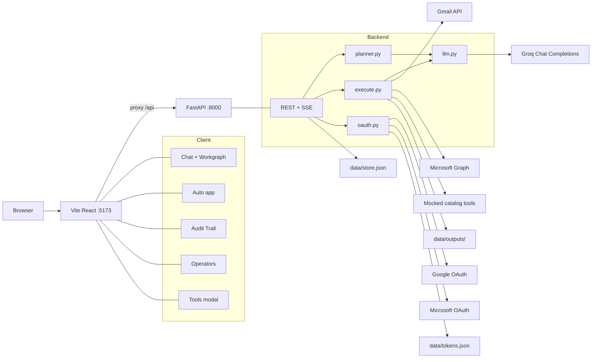
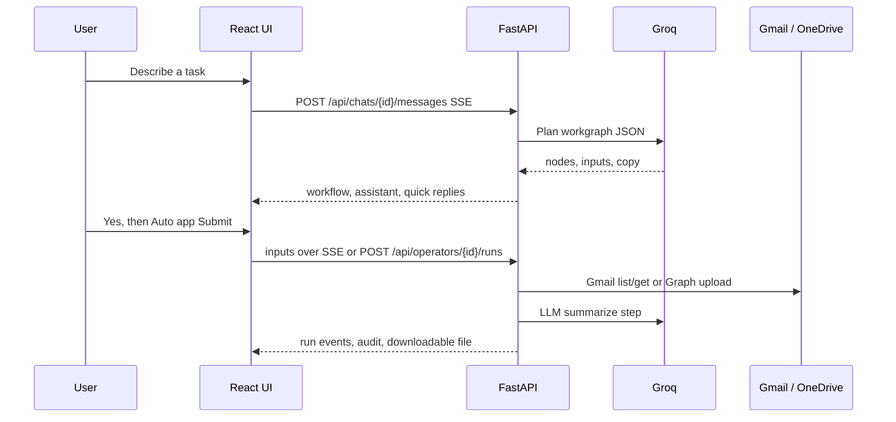

# prompt2flow architecture

Chat-to-workgraph planner. The React client describes a task, FastAPI turns it into a runnable graph with Groq, then executes steps against live Gmail/OneDrive or mocked catalog tools.

## System

Vite on **5173** serves the UI and proxies `/api` to FastAPI on **8000**. Planning and LLM nodes call Groq. Gmail and OneDrive are live after OAuth; Slack, Notion, Linear, and the rest of the catalog stay mocked.



## Request path



## Layout

```
web/src/                 React UI (Vite root)
  pages/                 Chat, Operators, Workbench
  components/            Workgraph, Auto app, Audit Trail, Tools
  store/app.ts           Zustand chat/run state
  lib/api.ts             fetch + SSE parsers
backend/app/
  main.py                FastAPI routes + SSE
  planner.py             Groq workgraph JSON
  execute.py             Node runner
  llm.py                 Groq Chat Completions
  oauth.py               Google + Microsoft OAuth
  catalog.py             Integration catalog
  store.py               JSON persistence
  integrations/
    gmail.py             Gmail list + get
    onedrive.py          Graph upload
data/
  store.json             chats, messages, runs, operators
  tokens.json            OAuth tokens (gitignored)
  outputs/               Local copies of run files
```

`npm run dev` starts Vite and `uvicorn app.main:app --reload --port 8000`.

## Client

| Surface | Role |
| --- | --- |
| `/` and `/c/:id` | Chat, workgraph, Auto app, audit for one thread |
| `/operators` | Saved workflows |
| `/operators/:id` | Re-run a saved workflow; audit lists every run |
| Tools modal | Connect/disconnect Gmail and OneDrive |

Chat sends `POST /api/chats/{id}/messages` and reads SSE (`notification`, `workflow`, `run`, `quick_replies`, `interrupt`, `assistant`, `operator-saved`, `chat-title`). Operators send `POST /api/operators/{id}/runs` and listen for `run` events.

## Backend modules

| Module | Role |
| --- | --- |
| `main.py` | Health, me, chats, operators, SSE, object download |
| `planner.py` | Structured workgraph from conversation + catalog |
| `execute.py` | Walk nodes; Gmail / LLM / OneDrive / generic mock |
| `llm.py` | Groq `https://api.groq.com/openai/v1` |
| `oauth.py` | Authorize, callback, refresh, disconnect |
| `gmail.py` | `users.messages.list` then `get` metadata |
| `onedrive.py` | `PUT /me/drive/root:/{filename}:/content` |
| `store.py` | `data/store.json` and `data/tokens.json` |

A Gmail or OneDrive step with no token fails with `Connect Gmail/OneDrive in Tools`. Tokens refresh on expiry or 401.

## Data

`data/store.json`

- `chats` — title, workflow, `latestRunId`
- `messages` — user/assistant copy, optional file link
- `runs` — activities, audit events, inputs, `workflowId`
- `operators` — saved workflow snapshot, `latestRunId`

`data/tokens.json` holds access/refresh tokens, expiry, and account email per live slug. `data/outputs/` holds a local copy of uploaded summaries for `/api/objects/download`.

## API

| Method | Path | Purpose |
| --- | --- | --- |
| GET | `/api/health`, `/api/me` | Liveness and demo profile |
| GET/POST | `/api/chats`, `/api/chats/{id}` | Chat CRUD |
| GET | `/api/chats/{id}/messages` | Thread + latest run |
| POST | `/api/chats/{id}/messages` | Plan, confirm, inputs, save operator (SSE) |
| GET | `/api/operators`, `/api/operators/{id}` | Operators; detail includes `runs` |
| POST | `/api/operators/{id}/runs` | Execute saved workflow (SSE) |
| GET | `/api/integrations`, `/api/integrations/me` | Catalog; connected only if a token exists |
| GET | `/api/integrations/{slug}/authorize` | OAuth start |
| GET | `/api/integrations/{slug}/callback` | Code exchange → `/?connected={slug}` |
| DELETE | `/api/integrations/{slug}` | Drop local tokens |
| GET | `/api/objects/download` | Local run file |

## OAuth

Redirect URIs:

- `http://localhost:8000/api/integrations/google_gmail/callback`
- `http://localhost:8000/api/integrations/microsoft_onedrive/callback`

Google: `gmail.readonly`, `userinfo.email`. Microsoft: `Files.ReadWrite`, `User.Read`, `offline_access`. Client IDs live in `.env` only (`GOOGLE_*`, `MICROSOFT_*`).
